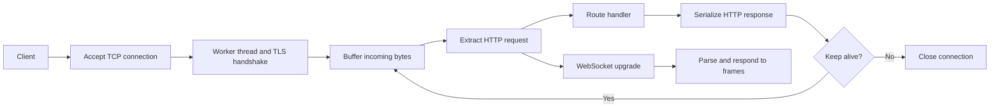

<div align="center">

# C++ HTTP & WebSocket Server

**From a TCP connection to HTTPS routes and WebSocket frames.**

`C++17` · `POSIX sockets` · `OpenSSL` · `HTTP/1.1` · `WebSocket` · `zlib`

[Quick start](#quick-start) · [Routes](#routes) · [Architecture](#architecture) · [Code map](#code-map)

Maintained by [Kuvlay Naman](https://github.com/kuvlay)

</div>

---

An educational networking server built directly on POSIX sockets. It accepts connections, negotiates TLS, buffers and parses HTTP requests, and either sends a response or upgrades the connection to WebSocket. The implementation keeps protocol handling visible instead of using a web framework.

## What is implemented

- TLS connections with OpenSSL and one worker thread per client.
- Buffered HTTP/1.1 request extraction using `Content-Length`.
- Keep-alive and pipelining over an existing connection.
- Echo, user-agent, file download and file upload routes.
- Optional gzip compression for echo responses.
- WebSocket upgrade, text echo, ping/pong, close frames and extended payload lengths.

## Architecture



The request buffer survives individual socket reads. This lets the server wait for incomplete requests and process multiple complete requests already received on the same connection. See [the request implementation](src/http/http.cpp) and [WebSocket handling](src/socket/websocket.cpp).

## Quick start

**Requirements:** Linux or WSL, a C++17 compiler, OpenSSL headers/libraries, zlib headers/libraries, and the OpenSSL command-line tool.

```bash
git clone https://github.com/kuvlay/http-server-cpp.git
cd http-server-cpp
mkdir -p certs /tmp/http-files

# Create a local development certificate; keep the private key out of Git.
openssl req -x509 -newkey rsa:2048 -nodes \
  -keyout certs/server.key -out certs/server.crt \
  -days 365 -subj "/CN=localhost"

g++ -std=c++17 -Isrc \
  src/main.cpp src/http/http.cpp src/http/routes.cpp \
  src/file/file.cpp src/gzip/gzip.cpp src/socket/websocket.cpp \
  -o server -pthread -lz -lssl -lcrypto

./server --directory /tmp/http-files/
```

Run from the repository root: the executable reads `certs/server.crt` and `certs/server.key` using relative paths. The listener is **HTTPS on port 4221**. Keep the trailing slash on the file directory argument.

The certificate is generated for local development. The following `curl -k` examples permit that self-signed certificate for these local requests.

## Routes

| Method | Path | Response |
| --- | --- | --- |
| `GET` | `/` | Empty `200 OK` response |
| `GET` | `/echo/<text>` | Echo text, optionally gzip-compressed |
| `GET` | `/user-agent` | Value of the `User-Agent` header |
| `GET` | `/files/<filename>` | File bytes, or `404` when absent |
| `POST` | `/files/<filename>` | Write the body; `201` on success |

In a second terminal:

```bash
curl -k -i https://localhost:4221/
curl -k -i https://localhost:4221/echo/hello
curl -k --compressed https://localhost:4221/echo/hello
curl -k -H 'User-Agent: portfolio-demo' https://localhost:4221/user-agent

curl -k -i -X POST --data 'Hello World' \
  https://localhost:4221/files/hello.txt
curl -k https://localhost:4221/files/hello.txt
```

### WebSocket behavior

Connect a WebSocket client to `wss://localhost:4221` with local self-signed certificates allowed. Text messages are echoed, ping frames receive pong frames, and close frames end the connection. The server parses masking and extended lengths; binary payloads are not handled as application messages.

## Code map

| Path | Responsibility |
| --- | --- |
| `src/main.cpp` | Socket listener, TLS context and worker creation |
| `src/http/` | HTTP data structures, parsing and route handlers |
| `src/file/` | File reads and writes |
| `src/gzip/` | zlib compression |
| `src/socket/websocket.cpp` | Upgrade handshake and frame handling |
| `test/` | Shell requests and Python/browser protocol experiments |

## Checks and current scope

The `test/` directory contains manual checks for routes, concurrent clients, persistent connections, pipelining and WebSocket behavior. Some older scripts use plaintext HTTP and need the HTTPS settings above; their presence is not a test-pass claim.

The parser uses case-sensitive header lookups and relies on `Content-Length`. Chunked transfer encoding, HTTP/2 and HTTP/3 are not implemented. File paths are concatenated without production-grade validation, and the server has no authentication or resource limits. Use trusted local requests and a disposable file directory while exploring it.

<details>
<summary>Project history and credits</summary>

Original development history and contributor attribution remain in Git. Existing notices are preserved; this documentation does not grant a new license.

</details>
