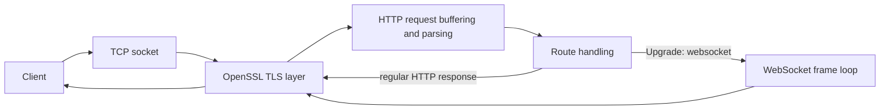

# C++ TLS HTTP / WebSocket Server

An educational from-scratch networking project built in C++ to explore how HTTP/1.1, TLS, file routes, and WebSocket upgrades work at the socket level.

This server is intentionally small and hands-on: it uses POSIX sockets directly, wraps each client connection in OpenSSL, parses requests manually, and routes responses without relying on a web framework.

## Features

- TCP server built with `socket()`, `bind()`, `listen()`, and `accept()`.
- TLS termination with OpenSSL using a self-signed development certificate.
- HTTP/1.1 request parsing and response serialization.
- `GET /` root route.
- `GET /echo/<text>` route, including optional `gzip` compression when requested.
- `GET /user-agent` route.
- `GET /files/<filename>` file download route.
- `POST /files/<filename>` file upload route.
- HTTP keep-alive and multiple requests over one client connection.
- HTTP pipelining support through buffered request extraction.
- Worker-thread-per-client concurrency.
- WebSocket upgrade handling.
- WebSocket text echo.
- WebSocket ping/pong and close frame handling.
- WebSocket frame parsing with support for extended payload lengths.

## Architecture

The server follows a simple network flow:



Each accepted client connection gets its own worker thread. The main thread only accepts new clients and hands the socket descriptor plus the OpenSSL `SSL` object to the worker. That worker then:

1. Completes the TLS handshake.
2. Reads bytes from the connection into a persistent buffer.
3. Extracts complete HTTP requests using `Content-Length`.
4. Routes the request to a handler or switches to WebSocket mode.
5. Sends the response with `SSL_write()`.

This design allows multiple clients to be served concurrently while still supporting multiple HTTP requests on the same connection.

## Technologies

- C++
- POSIX sockets
- OpenSSL
- HTTP/1.1
- WebSocket
- TLS
- zlib
- Linux / WSL

## Getting Started

### Requirements

- A Linux environment or WSL.
- `g++` with C++17 support.
- OpenSSL development headers and libraries.
- zlib development headers and libraries.

The repository already includes the development certificate files used by the server in `certs/`.

### Build And Run

The simplest way to start the server is to use the provided script:

```bash
chmod +x run.sh
mkdir -p /tmp/http-files
./run.sh
```

`run.sh` compiles the server and launches it with `--directory /tmp/http-files/`.

If you want to build manually, the command used by the script is:

```bash
g++ -Isrc \
  src/main.cpp \
  src/http/http.cpp \
  src/http/routes.cpp \
  src/file/file.cpp \
  src/gzip/gzip.cpp \
  src/socket/websocket.cpp \
  -o server -pthread -lz -lssl -lcrypto

mkdir -p /tmp/http-files
./server --directory /tmp/http-files/
```

The server listens on port `4221`.

## HTTP Examples

Because the current executable terminates TLS itself, the examples below use `https://` and `curl -k` for the self-signed certificate.

Basic request:

```bash
curl -k -i https://localhost:4221/
```

Echo route:

```bash
curl -k -i https://localhost:4221/echo/hello
curl -k -i -H 'Accept-Encoding: gzip' https://localhost:4221/echo/hello
```

File upload:

```bash
curl -k -i \
  -X POST \
  -H 'Content-Type: application/octet-stream' \
  --data 'Hello World' \
  https://localhost:4221/files/hello.txt
```

File download:

```bash
curl -k -i https://localhost:4221/files/hello.txt
```

Persistent connection reuse:

```bash
curl --http1.1 -k -v \
  https://localhost:4221/user-agent \
  -H 'User-Agent: orange/mango-grape' \
  --next \
  https://localhost:4221/echo/apple
```

## WebSocket / WSS

The server upgrades an HTTP/1.1 request to WebSocket when it receives a valid `Upgrade: websocket` handshake. Because TLS is enabled, connect with `wss://`.

```bash
npx wscat -c wss://localhost:4221 --no-check
```

Text echo:

```text
> hello
< hello
```

The implementation also handles control frames:

- Ping frames receive a pong response.
- Close frames are echoed back and the connection is closed.

## Implementation Details

The interesting part of this project was building the protocol handling directly instead of outsourcing it to a framework.

- The TCP server accepts client connections in a loop and spawns a worker thread per client.
- Each worker completes the TLS handshake with `SSL_accept()` before reading application data.
- HTTP requests are buffered across multiple `SSL_read()` calls so partial reads do not break request parsing.
- `tryExtractCompleteRequest()` uses the blank line separator plus `Content-Length` to determine when a request is complete.
- The request parser splits the request line and headers manually into `HttpRequest` and `HttpResponse` structures.
- Keep-alive is supported by leaving the TLS connection open unless the client sends `Connection: close`.
- Pipelined requests are handled by draining all complete requests already present in the receive buffer before reading again.
- File routes map `/files/<filename>` into a configurable directory passed on the command line.
- The `/echo/<text>` route can return gzip-compressed output when the client advertises `Accept-Encoding: gzip`.
- WebSocket upgrade handling validates the handshake headers and generates `Sec-WebSocket-Accept` from the client key.
- WebSocket frames are parsed by reading the fixed header, optional extended payload length, masking key, and payload.
- Client-to-server WebSocket frames are unmasked before being processed.
- Text frames are echoed back, ping frames are answered with pong frames, and close frames end the WebSocket loop.
- `SSL_write()` is wrapped in send loops so partial writes are handled correctly.

## Testing

The repository was tested locally with:

- `curl` for HTTP/1.1 and HTTPS requests.
- `curl --http1.1` for persistent connection reuse.
- Python TLS socket scripts for pipelining experiments.
- `wscat` for secure WebSocket connections.
- Manual verification of file upload/download, gzip responses, ping/pong, and close handling.

## Limitations

This is an educational project, not a production web server.

- The current binary speaks HTTP over TLS; it does not expose a separate plaintext HTTP listener.
- Request parsing is intentionally basic and is not a full RFC-complete HTTP parser.
- Chunked transfer encoding is not implemented.
- The server relies on `Content-Length` for request body extraction.
- WebSocket handling covers text, ping, pong, and close frames; binary frames are only logged.
- There is no HTTP/2 or HTTP/3 support.
- There is no load balancing, connection pool, authentication layer, or production hardening.

## What I Learned

Implementing this project made several networking concepts concrete:

- How a TCP connection is accepted and handed to application code.
- Why application protocols must tolerate partial reads and partial writes.
- How TLS sits between sockets and the HTTP/WebSocket logic.
- How HTTP keep-alive changes request lifecycle management.
- How WebSocket upgrades reuse the HTTP connection and switch into frame-oriented messaging.
- How WebSocket masking, payload length encoding, and control frames work on the wire.
- How worker threads simplify concurrent client handling in a small server.

## Project Status

Core HTTP/1.1 routing, HTTPS, WebSocket, and WSS functionality has been implemented and tested locally.